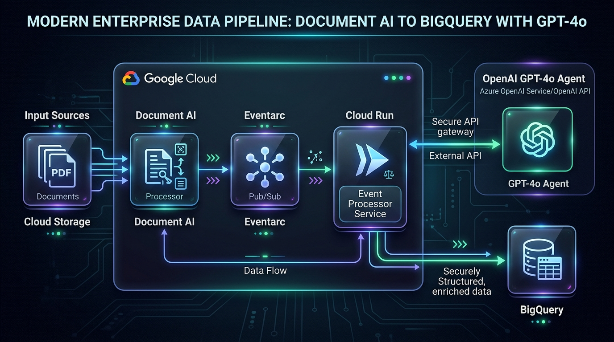
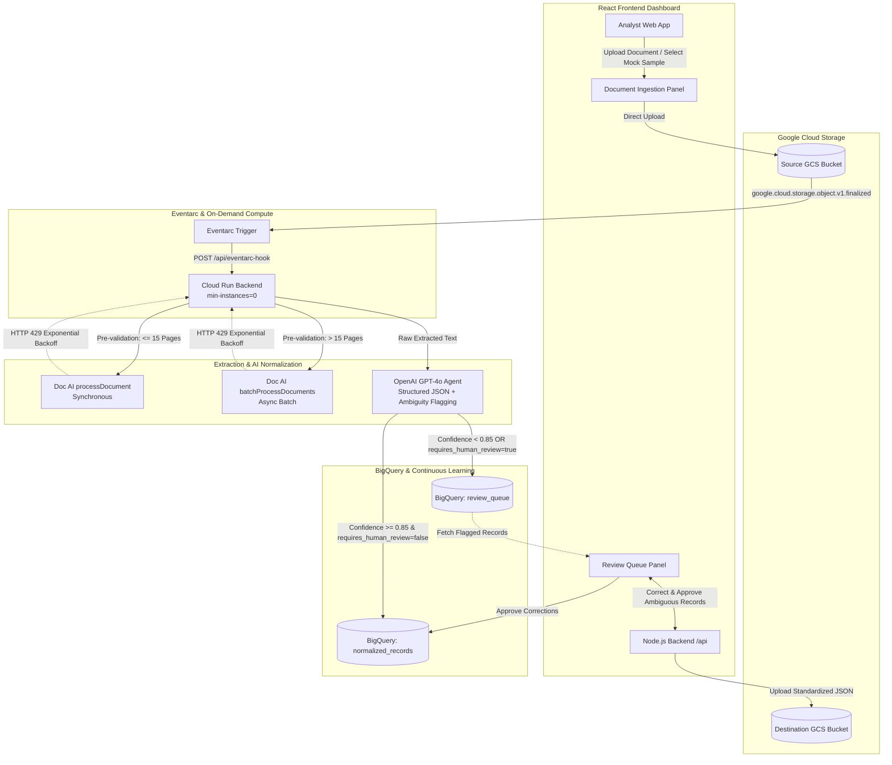

# Document Standardization Pipeline (`doc-standardization-pipeline`)

An enterprise event-driven full-stack document intelligence system featuring a **React (Vite + Tailwind CSS)** analyst dashboard and a **Node.js Express** backend. The system orchestrates Google Cloud Storage (GCS), Google Cloud Document AI, Eventarc, Cloud Run (with strictly enforced `min-instances=0`), OpenAI (GPT-4o structured agentic normalization), and Google Cloud BigQuery with a human-in-the-loop analyst feedback loop.

---

## 🏛️ System Architecture





---

## 📁 Repository Structure

```
doc-standardization-pipeline/
├── terraform/
│   ├── main.tf          # Provisions 2 GCS buckets, 1 SA, 1 Doc AI processor, 1 Cloud Run service (min-instances=0), 1 Eventarc trigger, BigQuery dataset & tables
│   ├── variables.tf     # Configurable project, region, processor, and bucket variables
│   └── provider.tf      # HashiCorp Google & Random providers
├── backend/
│   ├── src/
│   │   ├── app.js       # Express server (health check, Eventarc hook, BigQuery streaming, Review Queue)
│   │   └── services/
│   │       ├── documentAiService.js # Doc AI extraction, >15 page batch routing, HTTP 429 exponential backoff
│   │       └── openaiService.js     # GPT-4o agentic mapping, unit conversions, and ambiguity scoring
│   ├── package.json     # Node.js dependencies
│   └── Dockerfile       # Production container definition for Cloud Run
├── frontend/
│   ├── src/
│   │   ├── App.jsx      # React landing page, upload workflow, mock sample cards, and live pipeline monitor
│   │   ├── components/
│   │   │   └── ReviewQueue.jsx # Analyst Review Queue dashboard for human-in-the-loop correction
│   │   ├── main.jsx     # Vite React mount
│   │   └── index.css    # Tailwind CSS design system tokens
│   ├── public/
│   │   └── image_b9f2e2.png # Architecture diagram asset
│   ├── package.json     # React & Tailwind dependencies
│   ├── tailwind.config.js
│   ├── postcss.config.js
│   └── vite.config.js   # Vite configuration with API proxy
├── image_b9f2e2.png     # Architecture diagram placeholder in root
├── .env.example         # Environment template
└── README.md            # Complete operational documentation
```

---

## ⚡ Core Engineering Highlights

1. **Strictly On-Demand Serverless Compute**:
   - `google_cloud_run_v2_service` sets `min_instance_count = 0` to guarantee zero compute cost when idle.
2. **Page Pre-Processing & Dynamic Batch Routing**:
   - Node.js backend inspects document buffers upfront.
   - **<= 15 Pages**: Dispatches to synchronous `processDocument`.
   - **> 15 Pages**: Automatically switches execution path to asynchronous `batchProcessDocuments` via GCS staging and polling.
3. **Resilient Rate Limit Handling (HTTP 429)**:
   - Traps HTTP 429 and gRPC code 8 (`RESOURCE_EXHAUSTED`).
   - Implements exponential backoff with randomized jitter (`baseBackoff * 2^attempt + jitter`).
4. **OpenAI Agentic Standardization**:
   - Enforces structured JSON output via `response_format: { type: "json_object" }`.
   - Performs automated ISO 8601 date normalization, ISO 4217 currency conversions, and imperial-to-metric calculations (e.g. `lbs` to `kg`).
   - Generates confidence scores (0.0 to 1.0). If confidence < 0.85 or notation is ambiguous, flags field with `"requires_human_review": true`.
5. **Continuous Learning & Analyst Review Queue**:
   - Clean data streams into `normalized_records`.
   - Flagged extractions route to `review_queue`.
   - The React UI provides an interactive portal for analysts to correct values, add notes, and approve records, writing the remediated data to production.
6. **Mock Sample Testing**:
   - Native UI integration for `ps01_documents_metadata.csv` and `ps06_sample_rate_sheets.csv` with one-click ingestion.

---

## 🛠️ Local Development & Testing

### 1. Environment Setup
```bash
cd doc-standardization-pipeline
cp .env.example .env
# Provide OPENAI_API_KEY and GCP_PROJECT_ID
```

### 2. Backend Setup & Local Server
```bash
cd backend
npm install
npm run dev
# Running on http://localhost:8080
```

Verify backend health:
```bash
curl http://localhost:8080/api/health
# {"status":"ok","service":"doc-standardization-pipeline-backend","min_instances_enforced":0}
```

Trigger test extraction:
```bash
curl -X POST http://localhost:8080/api/test-extract \
  -H "Content-Type: application/json" \
  -d '{"raw_text": "RATE SHEET LANE-991\nDate: 04/10/2026\nFreight Rate: $2,450.00 / load\nFuel Surcharge: 15.2% (?)\nWeight: 42,000 lbs"}'
```

### 3. Frontend Setup & Local Development
```bash
cd ../frontend
npm install
npm run dev
# Running on http://localhost:3000
```

Open `http://localhost:3000` in your browser to access the Document Standardization Pipeline interface.

---

## 🚢 Production Deployment

### 1. Provision Infrastructure with Terraform
```bash
cd doc-standardization-pipeline/terraform
terraform init
terraform plan -var="project_id=YOUR_PROJECT_ID" -var="openai_api_key=YOUR_OPENAI_API_KEY"
terraform apply -auto-approve \
  -var="project_id=YOUR_PROJECT_ID" \
  -var="openai_api_key=YOUR_OPENAI_API_KEY"
```

### 2. Build & Deploy Backend Container to Cloud Run
```bash
cd ../backend

export PROJECT_ID="YOUR_PROJECT_ID"
export REGION="us-central1"
export SERVICE_NAME="doc-standardization-backend"
export IMAGE_URI="gcr.io/${PROJECT_ID}/${SERVICE_NAME}:latest"

# 1. Submit container build to Cloud Build
gcloud builds submit . --tag ${IMAGE_URI}

# 2. Deploy to Cloud Run with enforced min-instances=0
gcloud run deploy ${SERVICE_NAME} \
  --image ${IMAGE_URI} \
  --region ${REGION} \
  --service-account "docai-pipeline-sa@${PROJECT_ID}.iam.gserviceaccount.com" \
  --min-instances 0 \
  --max-instances 10 \
  --set-env-vars "OPENAI_API_KEY=YOUR_OPENAI_API_KEY,GCP_PROJECT_ID=${PROJECT_ID}"
```

### 3. Build & Host the Frontend Dashboard
```bash
cd ../frontend

# Build optimized production bundle with Vite
npm run build

# The output in frontend/dist can be hosted via Firebase Hosting, GCS static website, or Cloud CDN:
# gsutil -m cp -r dist/* gs://YOUR_FRONTEND_BUCKET/
```

---

## 📋 QA Verification Checklist

- [x] **Terraform Provisions Exactly**:
  - 2 GCS buckets (source documents, normalized JSON outputs).
  - 1 Document AI processor (`google_document_ai_processor`).
  - 1 Cloud Run backend service (`google_cloud_run_v2_service` with `min_instance_count = 0`).
  - 1 Eventarc trigger listening for `google.cloud.storage.object.v1.finalized` routing to `/api/eventarc-hook`.
  - 1 dedicated Service Account (`docai-pipeline-sa`) with `roles/storage.objectAdmin`, `roles/documentai.apiUser`, `roles/run.invoker`, `roles/bigquery.dataEditor`, and `roles/eventarc.eventReceiver`.
- [x] **HTTP 429 Exponential Backoff**:
  - Node.js `documentAiService.js` catches HTTP 429 and gRPC code 8 `RESOURCE_EXHAUSTED`, executing exponential backoff retries with randomized jitter.
- [x] **> 15 Pages Threshold Routing**:
  - Documents with > 15 pages automatically route to Document AI's `batchProcessDocuments` async method; <= 15 pages routes to `processDocument`.
- [x] **OpenAI Structured Normalization**:
  - Strict system prompt standardizes units (dates, currency, weights) and requires confidence scores. Flags low-confidence / ambiguous fields with `"requires_human_review": true`.
- [x] **React Frontend & Analyst Feedback Loop**:
  - App.jsx contains title "Document Standardization Pipeline" and verbatim `` architecture placeholder.
  - Review Queue component allows analysts to inspect, correct, and approve flagged items, streaming remediated data directly to BigQuery `normalized_records`.
  - Mock sample cards for `ps01_documents_metadata.csv` and `ps06_sample_rate_sheets.csv` allow immediate UI testing.
